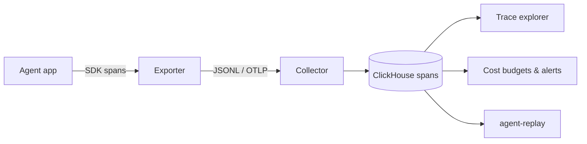

# Architecture — agent-tracer

## 1. Scope
Tracing for agent workloads: every step, tool call, LLM call, cost and error, in a tree.
**MVP:** zero-dependency SDK (context manager + decorator, contextvars parenting), JSONL exporter, auto-pricing, CLI `tree` and `stats`.
**Product:** OTLP-compatible collector, hosted search and analytics, cost budgets, alerts, auto-instrumentation.

## 2. System context

## 3. Components
| Module | Responsibility | Status |
|---|---|---|
| `Tracer.span` | Create span, set as current via `ContextVar`, capture error, compute duration and cost | MVP |
| `Tracer.trace` | Decorator wrapper | MVP |
| `MODEL_PRICES` | Prefix-matched price table → `cost_usd` | MVP |
| `build_tree` / `stats` | Reconstruct hierarchy, aggregate by kind, name, cost, errors | MVP |
| OTLP exporter | GenAI semantic conventions mapping | Roadmap |
| Auto-instrumentation | Wrap Anthropic, OpenAI and MCP clients | Roadmap |

## 4. Span schema
`{trace_id, span_id, parent_id, name, kind ∈ agent|llm|tool|retrieval|step, start, end, duration_ms, attrs{model, input_tokens, output_tokens, cost_usd, …}, status, error}`.
This is deliberately a subset of OTel spans, so the OTLP exporter is a pure mapping.

## 5. Design decisions
- **`contextvars` for parenting.** It's correct across threads and asyncio tasks without passing
  spans around explicitly.
- **Spans are emitted on end** (post-order). It's simpler and the duration is known.
  *Trade-off:* a crashed process loses open spans, so the product adds a start event for long spans.
- **Exceptions are recorded and re-raised.** The tracer must never change program behaviour.
- **Cost is computed at the edge,** but stored with the price table version so it can be recomputed.

## 6. Production architecture
- Collector (stateless) → Kafka → ClickHouse `spans` (`ORDER BY (tenant, trace_id, start)`), with
  materialised views for cost per agent per day.
- Sampling: always keep error traces and traces above the p95 cost. Head-sample the rest per tenant config.
- PII: attribute redaction rules run in the SDK before export (prompt bodies are opt-in).

## 7. SLOs
SDK overhead under 50 µs per span. Ingest-to-query p95 under 10 s.

## 8. Risks
Crowded market (LangSmith, Langfuse, Arize). The differentiators are zero-dependency adoption, cost
budgets that act (agentwarden revoke), and replay for non-engineers.
